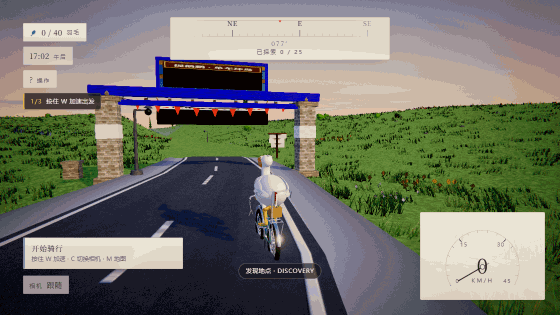

# 提鹅鹏 · 单车环岛 · A Pelican's Island Ride

[](https://github.com/cyberElar/pelican-island-ride/actions/workflows/ci.yml)

> A cinematic three.js cycling showcase: a pelican rides a vintage cruiser
> around a large, richly detailed island.
>
> **Everything is procedural.** Terrain, buildings, trees, creatures, textures,
> music and sound effects are all generated in code at runtime — no image files,
> no audio files, no glTF, no CDN, no network access.

**▶ Play it:** https://cyberelar.github.io/pelican-island-ride/
(or clone the repo and double-click `index.html` — it runs straight from `file://`)

[中文说明 · Chinese README](README.zh-CN.md)




---

## 60-second tour

1. `Enter` — start the ring-road time trial and follow the checkpoint gates.
2. `C` and `T` — swap the camera; walk the light from dawn to sunset to night.
3. `P` — photo mode (`V` cycles four grade filters, `X` exports a PNG); `M` opens the map.

40 golden feathers hide along the road, and 25 landmarks unlock discovery cards as you ride past.

## What's in the box

**The island** — 6 km x 6 km terrain: an 11 km ring road with dashes, edge lines,
gravel shoulders, lamp posts, guard rails and distance markers; beaches, cliffs,
alpine highlands, a lake with an islet, a river gorge crossed by a two-arch stone
bridge, broadleaf forest, pine woods, meadows, farm terraces.

**20 hand-built landmarks** — lighthouse (rotating beam at night), Seabreeze
Village (16 houses on most seeds, market square, fountain, laundry lines), fishing harbour with
bobbing boats, windmill, watermill with turning wheel, standing stones, treehouse,
watchtower ruins, sea arch and sea stacks, lake pavilion, hot-air balloons
(tethered, drifting), summit observatory, chapel with graveyard, start/finish
gates, shipwreck, waterfall, rope swing, cliff viewpoint.

**Living island** — 234 creatures at the high/ultra presets (163 on medium, 106 on low): seagulls, ducks, herons, rabbits, deer, crabs,
butterflies, bees, fireflies at night, jumping fish, a whale offshore, dolphins in
the bay. Six particle systems: pollen, falling leaves, chimney smoke, campfire
embers, waterfall mist, sea spray.

**Gameplay** — arcade bicycle physics (slope gravity, surface-dependent friction,
lean, jumps, crashes), 40 hidden golden feathers, 25 discoverable landmarks with
letterboxed name cards, an 8-checkpoint ring-road time trial with a stored best
lap (and a finish presentation), photo mode with depth of field, four grade
filters and PNG export, day/night cycle, weather, minimap, speedometer,
compass.

**The look** — custom sky shader (sun, moon, stars, milky way, two cloud layers),
Gerstner-wave ocean with shore foam, four-way blended terrain splat, PMREM
image-based lighting, and a post chain: bloom, screen-space god rays, split-tone
grade, vignette, chromatic aberration, film grain, SMAA, and photo-mode DoF.

**The sound** — fully synthesised WebAudio: wind, waves, forest birds, crickets,
seagulls, a harbour bell, tyre roll that changes with the road surface, chain
whirr, bell, splashes, crash, plus generative ambient music that follows the time
of day and your speed.

## Controls

| Key | Action |
| --- | --- |
| `W` / `↑` | pedal |
| `S` / `↓` | brake |
| `A` `D` / `←` `→` | steer |
| `Shift` | boost |
| `Space` | hard brake |
| `C` | camera: chase → first person → cinematic |
| `P` | photo mode (wheel = zoom, `F` = grid) |
| `V` | photo filter: original / sea film / golden hour / silver mono |
| `X` | save the current frame as a PNG |
| `M` | minimap |
| `B` | bell |
| `R` | return to the nearest road |
| `Enter` | start the ring-road time trial |
| `T` | time of day: dawn / noon / sunset / night / cycle |
| `N` | mute · `Esc` pause |

On a first visit a three-step goal strip walks you in: set off, ring the bell,
collect a feather (completion is remembered). Gamepad: left stick steers,
triggers pedal and brake. On touch screens a virtual
pad appears — drag the left half to steer, hold the right pad to pedal, and the
on-screen chips cover camera, map, photo, pause, bell, help and the time trial.
`?seed=1234` generates a different island, `?quality=low|medium|high|ultra` sets
the preset manually, `?debug=1` shows an fps / frame-time / draw-call overlay.

## Under the hood

- **three.js r186.1** (WebGL2), bundled with esbuild into a single IIFE so the
  game runs from `file://`.
- 16 modules in a small registry: sky, terrain, environment, ocean, vegetation,
  props, landmarks, animals, particles, weather, camera, controls, rider,
  collectibles, events, audio. Each one is a factory returning
  `{ group, update(dt, state), setQuality? }`.
- 488 geometries, 195 procedural textures, ~75 shader programs; the composite
  frame runs ≈280–475 draw calls and 2.1–4.4 M triangles at the *high* preset,
  depending on where you are (shadows and post-processing included). Ground
  cover is culled by distance (1.3 km at high), flowers are batched over 2 km
  blocks and the character's static meshes are merged per material, so neither
  the far field nor the rider pays for draw calls it cannot use. Per-camera
  numbers for all four presets: `docs/research/perf-baseline.md`.
- Full island build takes ~4–5 s at the *high* preset on a desktop CPU (up to
  ~13 s while the machine is busy or throttled), then streams at interactive
  frame rates; the loading screen reports progress and the console logs
  per-stage timings.

## Development

```bash
npm install          # three + esbuild + playwright-core (dev only)
npm run build        # -> dist/game.js (minified)
npm run build:publish# also refresh the playable root copies (game.js, styles.css)
npm test             # 11 module test suites, all headless in Node
npm run smoke        # browser smoke test (headless chromium, file:// build)
npm run serve        # dev server at http://localhost:5577/
npm run shots:readme # regenerate screenshots/ from the root build
```

The deployable site is the repository root: `index.html` + `game.js` +
`styles.css`. `game.js` and `styles.css` are built artefacts committed on
purpose so GitHub Pages can serve the game without a CI step.

## Repository layout

```
index.html          entry point (also the GitHub Pages index)
game.js             built bundle (three.js + all game code)
styles.css          built UI stylesheet (source: src/ui/styles.css)
src/
  core/             engine, settings, input, procedural textures, audio, utils
  world/            layout (island math), terrain+roads, sky, ocean, environment,
                    vegetation, props, landmarks, animals, particles, weather
  character/        pelican, bicycle, rider rig
  gameplay/         controls, camera director, collectibles, events
  fx/               post-processing chain
  ui/               HUD, menus, stylesheet
tools/              build, static server, screenshot harness, module test suite
docs/SPEC.md        the technical spec the modules were built against
screenshots/        README images (captured from the root build)
```

## License

MIT — see [LICENSE](LICENSE). Have fun, and ring the bell. 🔔
